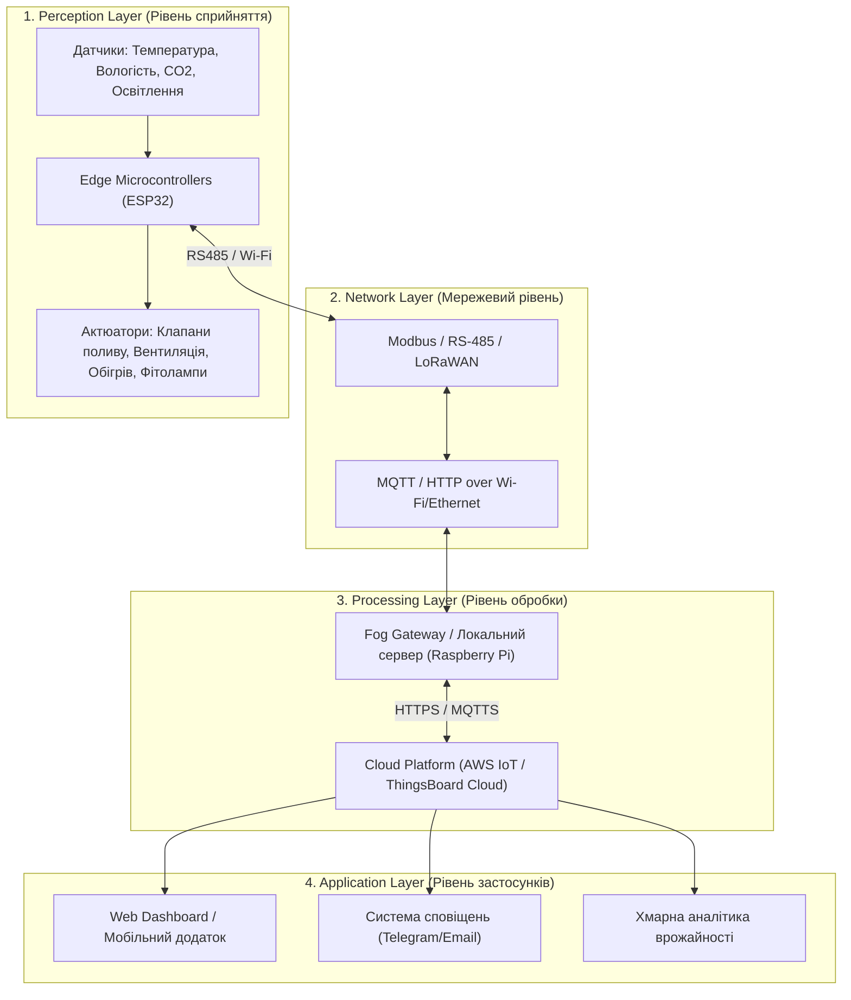

# Практична робота №1: Вступ до IoT та SMART-технологій
**Дисципліна:** Технології IoT та SMART-технологій  
**Варіант 1:** Розумна теплиця (площа 200 м²)  

---

## 1. Мета роботи
Спроєктувати систему автоматичного вирощування для розумної теплиці площею 200 м² на рівні архітектури: визначити склад пристроїв, обрати рівні обробки даних (Edge/Fog/Cloud), розрахувати добовий обсяг телеметрії, розробити чотирирівневу архітектурну діаграму та проаналізувати загрози безпеки.

---

## 2. Склад системи
Нижче наведено перелік датчиків та виконавчих пристроїв для автоматизації мікроклімату теплиці.

| Назва пристрою | Тип пристрою | Що вимірює або робить | Де розміщено |
| :--- | :--- | :--- | :--- |
| **DHT22 / SHT31** | Датчик | Вимірює температуру та відносну вологість повітря | На висоті 1.5 м у різних секціях теплиці (4 шт.) |
| **Capacitive Soil Moisture Sensor v1.2** | Датчик | Вимірює рівень вологості ґрунту | У прикореневій зоні рослин по грядках (8 шт.) |
| **BH1750** | Датчик | Вимірює рівень освітленості (люкси) | У верхній частині теплиці під стелею (2 шт.) |
| **MH-Z19B** | Датчик | Вимірює концентрацію вуглекислого газу ($CO_2$) | У центральній зоні теплиці (2 шт.) |
| **Електромагнітний клапан / Насос** | Актюатор (виконавчий) | Подає воду для крапельного поливу | На вузлі водопостачання та магістралях |
| **Вентилятори та сервоприводи кватирок** | Актюатор (виконавчий) | Забезпечують провітрювання та циркуляцію повітря | У торцях теплиці та на даху |
| **LED фітолампи** | Актюатор (виконавчий) | Досвітлюють рослини при недостатньому сонці | Над грядками/стелажами |
| **Електричний / Водяний калорифер** | Актюатор (виконавчий) | Здійснює обігрів теплиці в холодний період | Уздовж периметра теплиці |

---

## 3. Розрахунок добового обсягу телеметрії

### Вхідні дані:
* **Загальна кількість датчиків:** 16 шт. (4 $\times$ температура/вологість, 8 $\times$ вологість ґрунту, 2 $\times$ освітленість, 2 $\times$ $CO_2$).
* **Періодичність опитування:** 1 раз на 10 секунд (6 вимірів на хвилину).
* **Розмір одного пакета телеметрії (JSON/Binary):** ~128 байт.

### Розрахунок:
1. **Кількість відпрацювань за добу:**  
   $$\text{Запитів на добу} = 16 \text{ пристроїв} \times \left(\frac{60 \text{ с}}{10 \text{ с}} \times 60 \text{ хв} \times 24 \text{ год}\right) = 16 \times 8640 = 138\,240 \text{ вимірів}$$

2. **Загальний обсяг даних per day:**  
   $$\text{Обсяг} = 138\,240 \times 128 \text{ байт} = 17\,694\,720 \text{ байт} \approx 17.69 \text{ МБ/добу}$$

*Висновок:* Добовий обсяг телеметрії становить близько **17.7 МБ**, що є помірним навантаженням і легко передається через локальну мережу чи IoT-шлюз.

---

## 4. Обґрунтування розміщення обробки даних (Edge, Fog, Cloud)

* **Edge (На межі):**  
  * *Що обробляється:* Первинне зчитування з датчиків микроконтролерами (ESP32/STM32), фільтрація шумів, аварійні тригери (наприклад, критичне перевищення температури чи заморозки).
  * *Вимога до затримки:* **$< 100 \text{ мс}$**. Швидка реакція захищає врожай від перегріву або замерзання.
* **Fog (Локальний шлюз / Локальний сервер):**  
  * *Що обробляється:* Локальна автоматика теплиці (Raspberry Pi або промисловий контролер). Логіка поливу за розкладом, підтримка балансу $CO_2$, керування вентиляцією та фітолампами, збереження локального логу.
  * *Вимога до затримки:* **$< 1-2 \text{ с}$**.
* **Cloud (Хмара):**  
  * *Що обробляється:* Довгострокове збереження історії, візуалізація дашбордів для користувача, побудова аналітичних моделей росту рослин, прогнозування витрат ресурсів, віддалене сповіщення.
  * *Вимога до затримки:* **$1-5 \text{ с}$** (некритично для прямого управління).

### Сценарій автономності при втраті зв'язку з хмарою:
Якщо інтернет-з'єднання із хмарою втрачається, локальний Fog-сервер (шлюз) переходить в **автономний режим**. Всі локальні сценарії (автоматичний полив за показниками вологості ґрунту, вмикання обігріву/провітрювання) продовжують виконуватися локально на підставі збережених конфігурацій. Дані телеметрії буферизуються на локальному накопичувачі та синхронізуються з хмарою після відновлення зв'язку.

---

## 5. Архітектурна діаграма системи (Mermaid)

## 6. Безпека системи

1. **Перехоплення та підміна даних (Man-in-the-Middle)**
   * **Загроза:** Перехоплення та модифікація покажчиків датчиків під час передачі.
   * **Захід протидії:** Використання шифрованих протоколів MQTTS / HTTPS з TLS/SSL.

2. **Несанкціонований доступ до панелі керування**
   * **Загроза:** Зловмисник отримує доступ до керування обігрівом чи поливом.
   * **Захід протидії:** Двофакторна автентифікація (2FA), авторизація за JWT-токенами та модель доступу RBAC.

3. **DDoS-атака на локальний шлюз**
   * **Загроза:** Перевантаження контролера шлюзу запитами для зупинки роботи системи.
   * **Захід протидії:** Налаштування Rate Limiting, фаєрволу (iptables) та розміщення пристроїв у приватній мережі (VLAN).
  

## 7. Джерела

1. *Mermaid Documentation.* URL: https://mermaid.js.org/ (дата звернення: 10.10.2026).
2. *ThingsBoard IoT Architecture Overview.* URL: https://thingsboard.io (дата звернення: 10.10.2026).
3. *ESP32 Technical Reference Manual (Espressif Systems).* URL: https://www.espressif.com/ (дата звернення: 10.10.2026).
